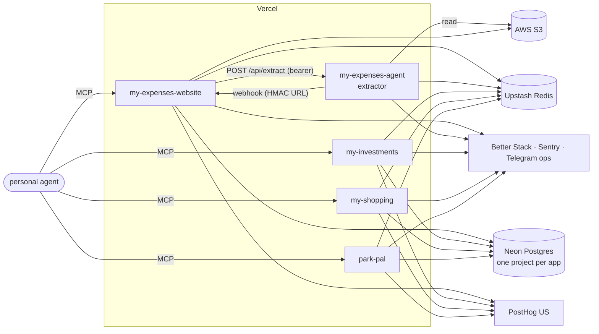

# System map

Load before adding a service, a cron, a data store or an external API to any suite app.

## Apps

| App | Repo | Production | Shape |
| --- | --- | --- | --- |
| Expenses | `my-expenses-website` | https://my-expenses-website.vercel.app | Next.js app: UI, API, crons, MCP, Telegram bot |
| Expenses extractor | `my-expenses-agent` | https://my-expenses-agent.vercel.app | Express service: statement Excel → transactions, async with a webhook back |
| Investments | `my-investments` | https://my-investments-rose.vercel.app | Next.js app: UI, API, daily snapshot cron, advisor chat, MCP |
| Shopping | `my-shopping` | https://yaniv-shopping.vercel.app | Next.js PWA: UI, API, recurring-items cron, MCP, `/agent` pages |
| Parking | `park-pal` | https://park-pal-three.vercel.app | Next.js PWA: UI, API, MCP, `/agent` pages |

Every app is one Vercel project under `yaniv120892s-projects` (`vercel project ls`), deployed by
Vercel's Git integration: each branch gets a preview, `main` goes to production. No repo holds a
deploy workflow.

`my-expenses-agent` is the statement extractor; the Expenses *personal agent* is
`my-expenses-website`'s `/api/mcp`. `my-expenses-app` is an earlier monorepo of the whole Expenses
system and is not deployed.

## External services

| Service | Used by | For |
| --- | --- | --- |
| Neon Postgres | every Next.js app | the only store of record → [data.md](data.md) |
| Upstash Redis | every app | counters, codes, caches, sessions (Expenses) → [data.md](data.md) |
| AWS S3 | Expenses, extractor | statement uploads, attachments, backups |
| Google Drive | Expenses | backups, when `BACKUP_STORAGE_PROVIDER_TYPE` picks it |
| Better Stack | every app | warn+ logs, uptime monitors, cron heartbeats → [observability.md](observability.md) |
| Sentry | every app | errors only |
| Telegram | every app | ops alerts (one shared bot and chat); Expenses user notifications; Investments daily summary |
| PostHog (US, project 692842) | every Next.js app | server-side product events; weekly report from the `observability` repo |
| SMTP (Gmail) | every Next.js app | sign-in codes and links; Expenses monthly report |
| Google OAuth | Shopping, Parking | sign-in |
| OpenAI / Gemini | Expenses, Investments, Shopping, extractor | categorisation, advisor and assistant chat, recipe import, extraction |
| Finnhub, Binance, TASE Maya, Frankfurter | Investments | prices and FX |
| Bank of Israel | Expenses | exchange rates |
| Nominatim | Parking | reverse geocoding |

## Crons

Vercel Cron, in UTC. Each app's `vercel.json` is the list; each cron route takes `CRON_SECRET` as a
bearer token and pings its own Better Stack heartbeat on success. The weekly traffic report is the
one GitHub Actions cron, in the `observability` repo.

## Region

An app's functions run in the region of its database, so each query stays a short round trip.
Expenses and Investments run in `fra1` with Neon and Upstash in Frankfurt; Investments must, because
Binance refuses US-hosted callers. Shopping's database is in `us-east-1`, so it keeps Vercel's
default US region. Moving an app means moving its database first. A new app starts in `fra1` with
its databases in Frankfurt.
